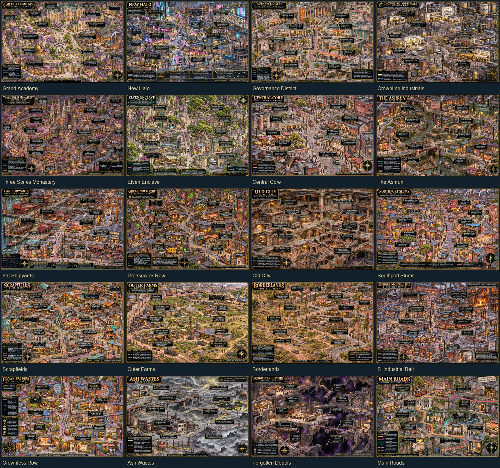

# District lore review — November 6, 2026



This pass checks the new district illustrations against GoblinNib's public World
Anvil material, then develops original local details within those constraints.
It does not promote newly invented names, layouts, branches, or connections to canon.

## Sources and decisions

| Source | What it constrains | Decision |
| --- | --- | --- |
| [Adyta](https://www.worldanvil.com/w/adyta-jeeperssheefers/a/adyta-settlement) | District identities, surface transit, contrasting layers of the city | Avoid uniform high-fantasy architecture; no subway; do not turn rumored discoveries into landmarks. |
| [Grand Academy](https://www.worldanvil.com/w/adyta-jeeperssheefers/a/the-grand-academy-landmark) | Scholarship, archives, professional legitimacy; isolated research systems | Separate technical facilities from magical laboratories. Local building names remain proposals. |
| [New Halo](https://www.worldanvil.com/w/adyta-jeeperssheefers/a/new-halo-settlement) | Professional wealth, redevelopment, legacy households, southward pressure | Replace cathedral-like grandeur with glass, concrete, commercial media and an uneven redevelopment edge. |
| [Elves](https://www.worldanvil.com/w/adyta-jeeperssheefers/a/elves-species) | Maintained Enclave buildings, gardens and practical infrastructure | Show maintenance and age; avoid treating elven comfort as automatic supernatural ecology. |
| [Greasewick Row](https://www.worldanvil.com/w/adyta-jeeperssheefers/a/greasewick-row-settlement) | Southern Low Halo repair work and mixed-species workshop life | Use compact repair bays, salvage and homes, with suggested shops rather than new asserted institutions. |
| [Old City](https://www.worldanvil.com/w/adyta-jeeperssheefers/a/old-city-settlement) | Buried former streets and buildings | Replace the first pass's surface-like historic quarter with an underground cutaway. |
| [Civic Institutions](https://www.worldanvil.com/w/adyta-jeeperssheefers/a/civic-institutions-article) | Distinct responsibilities and fragmented public services | Proposed branch locations do not imply established headquarters or a unified command. |
| [Corporations](https://www.worldanvil.com/w/adyta-jeeperssheefers/a/corporations-article) | Different corporate functions | Keep utilities, enforcement, freight, medicine and media distinct. |
| [Low Halo](https://www.worldanvil.com/w/adyta-jeeperssheefers/a/low-halo-settlement) | Neighborhood geography and connection to Greasewick | Preserve existing Low Halo artwork and pins; record discrepancies for a separate revision. |

The public Elven Enclave settlement page is a stub; its species article supplies
more useful architectural context. Searches did not locate substantive dedicated
public articles for several other districts. Their briefs use the city overview
and existing PDA descriptions without implying an exhaustive World Anvil crawl.
No public Crownless Row article was found. The user explicitly authorized its
development from the PDA description, marked provisional.

## What is established and what is being designed

`data/district-map-briefs.json` keeps source URLs, a concise lore anchor, original
visual direction and ten original annotation entries per map. New named shops,
streets, courts, branch offices and hazard markers are design proposals. Two New
Halo names already appear in source material, but their precise placements here
remain proposed. A source URL on a candidate is evidence for its district context,
not a claim that the page contains that candidate's invented name.

The rendered footer identifies candidate status and proposed local names. Candidate
places in the PDA have `[candidate]` in their displayed names and an explicit note
in their descriptions. Coordinates are approximate, derived from the illustration
brief; they require a manual pin-position pass before acceptance. Main Roads stays
a schematic overview with annotations rather than becoming ten travel destinations.

No travel durations, existing place coordinates, or existing routes are changed.
Old City's catalog layer is corrected from surface to underground.
No precise scale, newly confirmed district adjacency, deity, corporate headquarters,
or hidden supernatural asset is inferred from a painting. Deep-map route breaks
and uncertainty are intentional. Ash Wastes contains hazard annotations, not a
new residential community.

## Comparison with the previous maps

Low Halo and Three Wires/Tangle set the standard for readable destination callouts,
leader dots, routes and local practical notes. Noble Heights demonstrates how
palette and architecture can vary. Those maps are visual references, not evidence
that every printed name or spatial relationship is already canon.

One existing discrepancy remains: the Low Halo article places Saint Static Arms
near the middle of the district east of Mercy, while the current painted map puts
it closer to the north. The existing image and its pins are left intact rather
than silently moving an established location during this new-district pass.

First-pass images remain at `maps/candidates/<district>.jpg`. Detailed revisions
use `-v2.jpg`; the shared catalog selects the revised image. This keeps the original
render reviewable and avoids losing previous work.

## Reproducing the import

`tools/prepare-district-lore.py` writes the source-linked brief catalog from its
reviewed draft definitions. To import generated PNGs, provide a local JSON array
of `{ "id": "district-id", "path": "absolute PNG path" }` entries to:

```powershell
py -3 tools/import-district-lore.py C:/path/to/local-render-sources.json
```

The importer preserves existing `-v2.jpg` files and the first-pass images. Further
art revisions should use another versioned filename. The source-list file is local
working metadata and is not required by the deployed PDA.

## Validation

`npm test` passes, including 210 desktop/phone browser checks. The browser loads
all twenty selected candidate images at their registered dimensions and verifies
candidate disclosures and source links. All 28 catalog image dimensions were
checked independently. The 125 pre-existing place records and 43 route records
remain unchanged. There are 200 annotation records, with 190 candidate place pins;
the Main Roads schematic does not add travel destinations. Approximate pin
placement and proposed names still require editorial acceptance.
