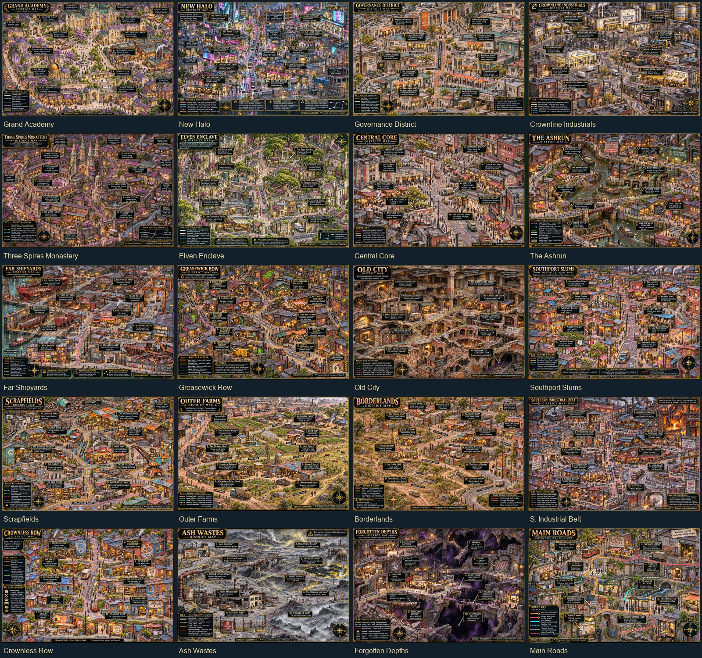

# District map coverage



The detailed second pass is documented in [District lore review](DISTRICT_LORE_REVIEW.md).
It adds World Anvil source links, original named location proposals, and versioned
`-v2.jpg` illustrations. The first-pass files below remain available for comparison;
the shared catalog selects the detailed revisions as they are imported.

[First-pass overview for comparison](district-maps-preview.jpg)

The November 6, 2026 map pass adds illustrated design candidates for every entry
that lacked map coverage on `main` at commit `2238ed0`: nineteen districts and
the Main Roads network overview. Existing official and candidate artwork remains
in place, including the shared Three Wires/Tangle and Sewers Town/Deep Tunnels maps.

New pages live in `maps/candidates/` as quality-85 optimized JPGs. Their titles,
dimensions, candidate status, and district links are registered in
`data/places.json`. Both Explore and the City's expanded map pages read that
catalog. Existing curated City map notes retain their wording and image choice.

These are proposed illustrations based on the district taglines and dossiers,
not approved geography. Building arrangements, generic labels, scale markings,
and illustrated transit are illustrative. They do not establish travel times,
operating service, named places, or canonical adjacency. The initial twenty-map pass did not change saved character data, existing place
coordinates, or route durations. The subsequent [Sewers redraw](SEWERS_MAP_REDRAW.md)
reprojects its existing pins to the new artwork. Use Explore's Edit
pins to add confirmed places after the layouts are accepted.

`district-render-progress.json` records the render queue and imported dimensions.
Original generated PNGs remain in Codex's local generated-image folder. To import
them again, provide a local JSON array of `{ "id": "district-id", "path":
"absolute PNG path" }` entries to:

```powershell
py -3 tools/import-district-renders.py C:/path/to/local-sources.json
```

The importer preserves existing JPGs. To revise a map, use a new versioned filename
and update its catalog reference deliberately. Large map images remain lazy-cached
by the service worker after first opening, keeping initial installation small.
