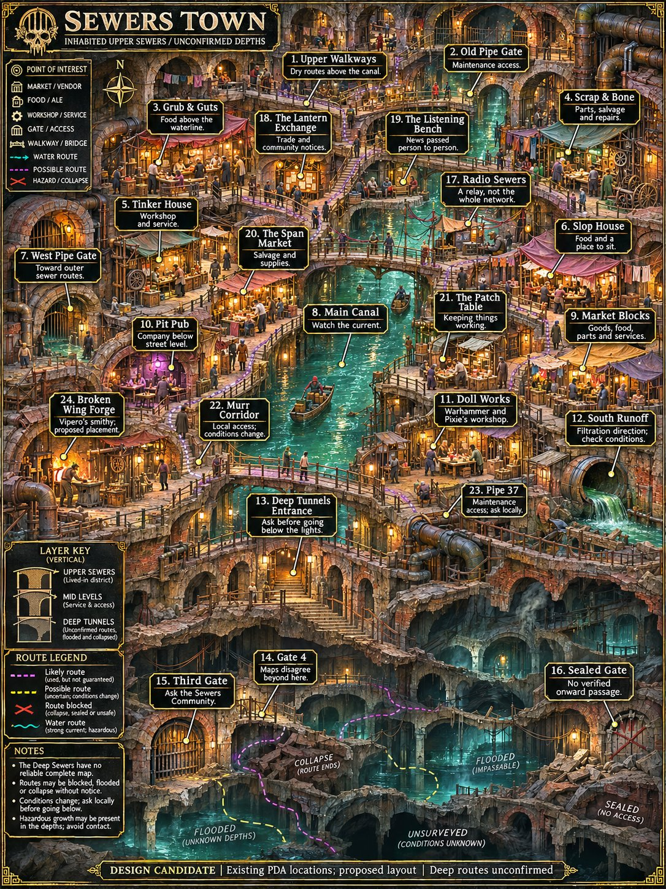

# Sewers Town redraw — November 6, 2026



The old artwork joins a painted upper town to a visibly separate diagram of the
deeper tunnels. This revision uses one continuous painted cutaway, with readable
callouts and routes above and incomplete, hazardous infrastructure below.

## Lore constraints

- [Sewers Community](https://www.worldanvil.com/w/adyta-jeeperssheefers/a/sewers-community-settlement): residents occupy repurposed drainage and abandoned works, with shared resources and practical repair networks. This is a lived neighborhood, not an empty dungeon.
- [Deep Sewers](https://www.worldanvil.com/w/adyta-jeeperssheefers/a/the-deep-sewers-location): the lower layer is contaminated and surveys conflict. Broken or dashed passages must not imply a complete reliable map.
- [Radio Sewers](https://www.worldanvil.com/w/adyta-jeeperssheefers/a/radio-sewers-organization): a distributed unofficial broadcast network. The illustrated point is a local relay, not a permanent central headquarters.
- [Adyta](https://www.worldanvil.com/w/adyta-jeeperssheefers/a/adyta-settlement): underground habitation is not a subway system. Broken Wing Forge is a named smithy; its precise position on this candidate layout is proposed.

The 23 existing PDA locations and their IDs are retained. Names found only in the
old PDA map or mission material are not newly certified as public World Anvil
canon. The redraw adds Broken Wing Forge as a source-supported name with an
approximate, proposed position near the inhabited community's edge.

Existing sewer pins are reprojected to this artwork and marked approximate. Their
before/after coordinates are recorded in `sewers-map-pin-migration.json`; names,
district assignments and IDs remain stable. Radio Sewers' description clarifies
its network role. No route duration changes are made.

Both Explore and the City map page select `maps/candidates/sewers-town-v2.jpg`.
The old `maps/official/sewers-town.jpg` and
`maps/sewers-town-district-map-deeper.jpg` remain available for comparison. The
service-worker cache advances to v81.

To repeat the local import with a generated PNG:

```powershell
py -3 tools/import-sewers-render.py C:/path/to/render.png
```

The importer preserves an existing version-two JPG. Further visual revisions
should use another versioned filename. The shared route catalog remains unchanged.

## Validation

`npm test` passes, including 214 desktop/phone browser checks. The selected sewer
image loads at its registered dimensions; all 24 pins render, including the deeper
gates and forge. The Radio Sewers panel describes a local relay, and Gate 4 retains
its conflicting-survey warning. All 315 previous place IDs survive, the 292
non-sewer place records are unchanged, and all 43 route records remain unchanged.
